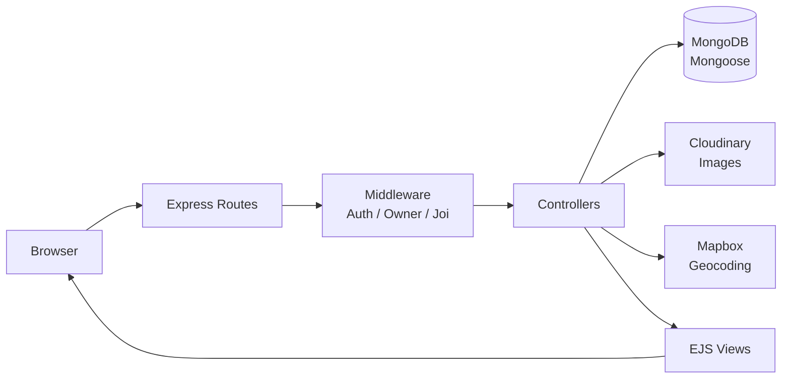

<div align="center">


<br/>

[](https://YOUR-TRIPSTAY-URL.onrender.com)
[](https://YOUR-SITE-NAME.netlify.app)
[](https://opensource.org/licenses/ISC)


</div>


## ✨ Overview

**TripStay** is a full-stack property rental platform inspired by Airbnb. Users can browse, list, search, and review properties, backed by secure authentication, geolocation-based maps, and cloud-hosted images.

<!-- Add screenshots at assets/screenshots/, then uncomment -->
<!--
<div align="center">
  
  
</div>
-->


## 🎯 Features

| | Feature | Details |
|:-:|---------|---------|
| 🔐 | **Authentication & Authorization** | Signup/login with Passport.js (local strategy). Ownership-based middleware ensures only owners can edit or delete their listings and reviews. |
| 🏠 | **Listings CRUD** | Create, view, update, and delete listings with server-side validation using Joi. |
| 🖼️ | **Image Uploads** | Images are uploaded via Multer and stored on Cloudinary, removing dependence on local disk storage. |
| 🗺️ | **Geolocation & Maps** | Mapbox Geocoding turns addresses into coordinates. Cluster maps show all listings, and each listing page has its own map. |
| ⭐ | **Reviews & Ratings** | Star ratings and comments on listings. Only a review's author can delete it. |
| 🔎 | **Search & Filtering** | Search by city and browse curated categories (Trending, Mountains, Castles, Camping, and more) with themed landing pages. |
| 💬 | **Flash Messages** | Instant success and error feedback via connect-flash. |
| 📱 | **Responsive UI** | Bootstrap 5 and custom CSS, with reusable layouts through EJS and ejs-mate. |


## 🏗️ Architecture




## 🧰 Tech Stack

<div align="center">


</div>

| Layer | Technology |
|---|---|
| Backend | Node.js, Express.js |
| Database | MongoDB, Mongoose |
| Templating | EJS, ejs-mate |
| Styling | Bootstrap 5, CSS |
| Authentication | Passport.js, passport-local-mongoose |
| File Storage | Cloudinary, Multer |
| Maps & Geocoding | Mapbox GL JS, Mapbox Geocoding API |
| Validation | Joi |
| Sessions | express-session, connect-flash |


## 💡 What This Project Solves

| Problem | Solution |
|---|---|
| 🔒 **Unauthorized access** | Ownership middleware (`isOwner`, `isReviewAuthor`) so users can only modify their own content. |
| 🧹 **Orphaned data on delete** | A Mongoose `post("findOneAndDelete")` hook cascades and removes a listing's reviews. |
| ☁️ **Scalable image storage** | Uploads go to Cloudinary instead of the server's disk. |
| 🛡️ **Repetitive error handling** | A custom `ExpressError` class and async wrapper centralize error handling across routes. |
| 🧭 **Content discoverability** | Category filters, city search, and Mapbox cluster maps help users find listings fast. |


## 📁 Project Structure

```bash
Tripstay/
├── controllers/       # Route logic (listings, reviews, users)
├── models/            # Mongoose schemas (Listing, Review, User)
├── routes/            # Express routers
├── views/             # EJS templates (layouts, includes, pages)
├── public/            # Static assets (CSS, JS)
├── utils/             # ExpressError, wrapAsync helpers
├── middleware.js      # Auth, ownership, and validation middleware
├── cloudConfig.js     # Cloudinary + Multer storage setup
├── schema.js          # Joi validation schemas
├── app.js             # App entry point
└── package.json
```

## ⚙️ Getting Started

### Prerequisites

- Node.js (v18+ recommended)
- MongoDB (local or MongoDB Atlas)
- Cloudinary account (image storage)
- Mapbox account (geocoding and maps)

### Installation

**1. Clone the repository**

```bash
git clone https://github.com/mayank5463/Tripstay.git
cd Tripstay
```

**2. Install dependencies**

```bash
npm install
```

**3. Create a `.env` file in the project root**

```env
MONGO_URL=your_mongodb_connection_string
MAP_TOKEN=your_mapbox_access_token
CLOUD_NAME=your_cloudinary_cloud_name
CLOUD_API_KEY=your_cloudinary_api_key
CLOUD_API_SECRET=your_cloudinary_api_secret
SECRET=your_session_secret
```

> ⚠️ Never commit your `.env` file. Make sure `.env` is listed in `.gitignore`.

**4. Start the server**

```bash
node app.js
```

**5. Open** [`http://localhost:8080`](http://localhost:8080)


## 🛣️ Key Routes

<details>
<summary><b>Click to expand the route table</b></summary>
<br/>

| Method | Route | Description |
|---|---|---|
| GET | `/listings` | View all listings |
| GET | `/listings/new` | New listing form (auth required) |
| POST | `/listings` | Create a listing |
| GET | `/listings/:id` | View a single listing |
| PUT | `/listings/:id` | Update a listing (owner only) |
| DELETE | `/listings/:id` | Delete a listing (owner only) |
| POST | `/listings/:id/reviews` | Add a review (auth required) |
| DELETE | `/listings/:id/reviews/:reviewId` | Delete a review (author only) |
| GET | `/listings/search?city=` | Search listings by city |
| GET | `/listings/category/:category` | Filter listings by category |
| GET/POST | `/signup` | User registration |
| GET/POST | `/login` | User login |
| GET | `/logout` | User logout |

</details>

## 🔮 Roadmap

- [ ] Pagination for listings
- [ ] Unit and integration tests
- [ ] Wishlist / favorites feature
- [ ] React-based frontend for search and reviews

## 🤝 Connect

<div align="center">

[](https://github.com/mayank5463)
[](https://linkedin.com/in/YOUR-HANDLE)
[](mailto:your.email@example.com)

⭐ **If you like this project, consider giving it a star!** ⭐

</div>

## 📜 License

Released under the [ISC License](https://opensource.org/licenses/ISC).


